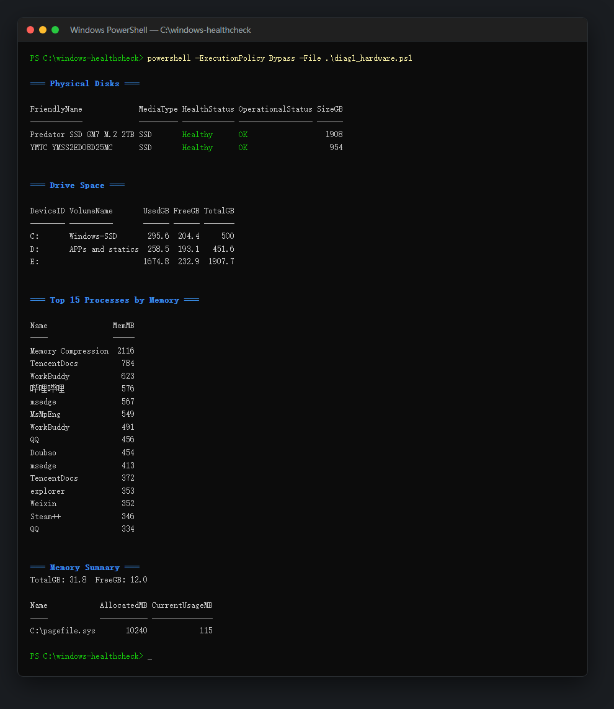

# windows-healthcheck · Windows 一键体检脚本集

一组**只读**的 PowerShell 诊断脚本，覆盖笔记本/台式机日常体检的主要方面：硬件健康、启动项、安全软件状态、系统稳定性、显卡驱动错误。不改系统、不删文件，跑完生成可留档对比的文本报告。

来自一次真实的笔记本体检（联想 + RTX 显卡 + 国产软件全家桶环境），脚本按「能回答真实问题」的标准写：磁盘 SMART 好不好、内存是不是双通道满速、显卡驱动 14 天内崩了几次、哪些软件在开机自启、C 盘还剩多少。

## 用法

`diag1_hardware.ps1` 的实际输出（本机真实运行，无任何改动）：



```powershell
# 一键体检（diag1~5），报告自动保存为 体检报告-<日期>.txt
powershell -ExecutionPolicy Bypass -File .\run_all.ps1

# AMD 显卡或需要额外排查模拟器虚拟网卡时：
powershell -ExecutionPolicy Bypass -File .\run_all.ps1 -GpuProviders 'amdkmdag','MuMuVMMNetLwf'

# 单独跑某一项（示例）
powershell -ExecutionPolicy Bypass -File .\diag1_hardware.ps1
powershell -ExecutionPolicy Bypass -File .\diag5_gpu_errors.ps1 -Providers nvlddmkm -Days 30

# 定向排查：点名任何可疑进程/计划任务/卸载残留
powershell -ExecutionPolicy Bypass -File .\diag6_targets.ps1 -Names '*Quark*','*Norton*','SDXHelper'
```

> 部分 CIM 查询与事件日志需要管理员权限才有完整结果；以管理员身份运行 PowerShell 效果最佳（diag4 会自报是否管理员）。

## 脚本清单

## 脚本清单

- **`diag1_hardware.ps1`** —— 物理磁盘 SMART / 分区空间 / 内存与页面文件 / Top15 内存进程。**重点看**：HealthStatus 非 Healthy、系统盘剩余 <10%。
- **`diag2_startup.ps1`** —— 电源计划 / 自启项（注册表 + 任务管理器批准列表）/ 非微软自动服务 / 待装更新 / 电池设计容量对比。**重点看**：不明自启项、电池损耗。
- **`diag3_security.ps1`** —— 注册杀软 / Run 键 / 休眠与快速启动 / HAGS / Defender 状态 / Temp 缓存 / 厂商计划任务（`-TaskPatterns` 可配）。**重点看**：实时保护关闭、病毒库过期、缓存异常大。
- **`diag4_system.ps1`** —— 管理员身份 / 内存条详情（双通道、频率）/ 页面文件 / 待重启标记 / 14 天错误事件 Top 来源 / 磁盘读写延迟 / 运行时长。**重点看**：RebootPending、高频错误来源、延迟 >5ms。
- **`diag5_gpu_errors.ps1`** —— 显卡驱动错误专项（`-Providers` 默认 nvlddmkm，`-Days` 默认 14）+ Schannel 错误。**重点看**：驱动重置事件量，多则需 DDU 清洁安装。
- **`diag6_targets.ps1`** —— 定向排查：`-Names` 点名的进程 / 计划任务 / 已安装产品。**重点看**：卸载残留、常驻更新器。

## 怎么读报告

1. 先看 diag1 的磁盘 HealthStatus 和 diag4 的错误事件 Top 来源——这两处最能暴露真问题
2. 显卡驱动重置（nvlddmkm 事件 Id 13/14/4101）偶发正常；14 天几十条就该 DDU 清洁重装驱动
3. "非微软自动服务"和厂商计划任务里不眼熟的名字，用 diag6 查路径，再决定是否禁用（**本脚本集只诊断，禁用/卸载请自己决策**）

## 声明

- 全部脚本只读，不修改任何系统设置
- 部分查询结果因权限不足可能为空，属正常现象

## License

MIT
